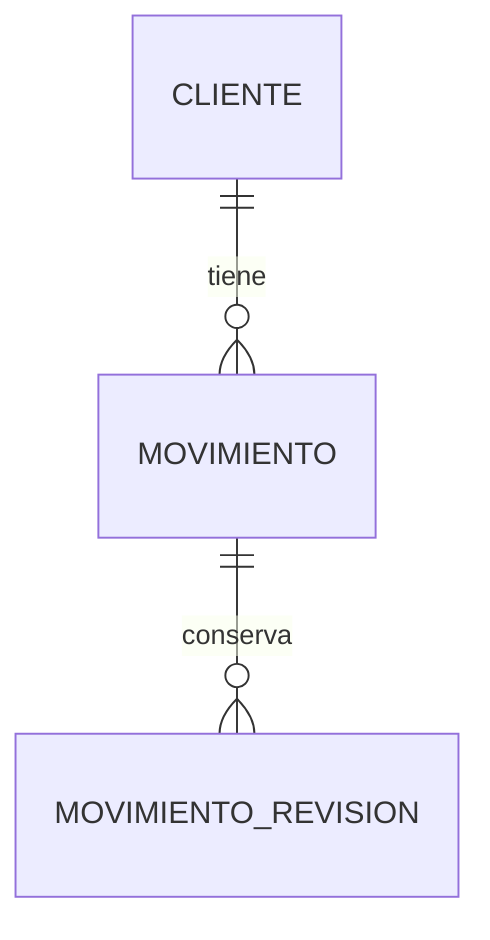

# 03 — Modelo de datos y reglas de integridad

Este documento define el modelo lógico. El esquema físico Room versión 1 y sus decisiones adicionales están en [13 — Persistencia local](13_Persistencia_Local.md).

## Convenciones

- Claves UUID v4 representadas como texto; no contienen nombre ni teléfono.
- Importes `INTEGER` en SQLite y `Long` en Kotlin, en pesos COP completos. No usar `Float`, `Double` ni centavos ficticios.
- Fechas del movimiento: `YYYY-MM-DD`, día civil en `America/Bogota`. Se muestran como `05/10/2026` o `5 oct 2026`.
- Instantes de auditoría: UTC con precisión de milisegundos; persistidos como epoch milisegundos y exportados en el mismo tipo entero. La UI los convierte a Bogotá.
- Todas las longitudes son límites de producto y se comprueban también al restaurar. Texto Unicode; no se elimina puntuación ni acentos del nombre mostrado.
- No se almacena un saldo editable ni una columna de saldo acumulado como autoridad.

## Relación de entidades



La base también contiene una fila de metadatos de libreta y registros operativos de backup. No hay tabla de productos, usuarios o facturas.

## Cliente

| Campo | Tipo / condición | Finalidad |
| --- | --- | --- |
| id | TEXT, PK, UUID | Identidad estable |
| nombre | TEXT, 1–120 caracteres tras trim, NOT NULL | Nombre visible |
| nombre_busqueda | TEXT, derivado, NOT NULL | Nombre normalizado para búsqueda |
| telefono | TEXT nullable, máximo 30 caracteres | Contacto opcional; admite +, espacios y separadores |
| nota | TEXT nullable, máximo 1.000 caracteres | Contexto libre |
| creado_en | INTEGER, NOT NULL | Instante de alta |
| modificado_en | INTEGER, NOT NULL | Último cambio, inicialmente igual al alta |
| activo | INTEGER booleano 0/1, NOT NULL | Activo o archivado |

Normalizar `nombre_busqueda` con minúsculas estables, descomposición Unicode, eliminación de marcas diacríticas y espacios consecutivos. Aplicar lo mismo a la consulta. No confiar en que `NOCASE` de SQLite resuelva todos los acentos. Buscar coincidencias por fragmento; escapar `%` y `_` en consultas `LIKE` parametrizadas. Los homónimos son válidos; mostrar teléfono/nota como ayuda.

Índice inicial `(activo, nombre_busqueda, id)` para orden y selección. Una búsqueda por fragmento puede recorrer filas; con 1.000 clientes es aceptable si cumple la medición. No agregar FTS en V1 por anticipación.

## Movimiento

| Campo | Tipo / condición | Finalidad |
| --- | --- | --- |
| id | TEXT, PK, UUID | También identifica el intento de registro |
| cliente_id | TEXT, FK a cliente, NOT NULL | Cuenta propietaria |
| fecha | TEXT ISO de día, NOT NULL | Fecha económica editable |
| orden_registro | INTEGER positivo, UNIQUE, NOT NULL | Desempate estable dentro de un día |
| tipo | TEXT: FIADO o ABONO, NOT NULL | Determina exclusivamente el signo |
| valor_cop | INTEGER entre 1 y 999999999, NOT NULL | Importe siempre positivo |
| descripcion | TEXT nullable, máximo 1.000 caracteres | Producto o nota libre |
| origen | TEXT: MANUAL o PAGO_TOTAL, NOT NULL | Distingue el atajo del pago completo |
| creado_en | INTEGER, NOT NULL | Instante del registro original |
| modificado_en | INTEGER, NOT NULL | Instante de última corrección/anulación |
| activo | INTEGER booleano, NOT NULL | Vigente o anulado |
| version | INTEGER >= 1, NOT NULL | Control de edición concurrente |

Restricciones: `PAGO_TOTAL` solo puede acompañar `ABONO`. El tipo FIADO usa MANUAL. Editar el importe de un abono PAGO_TOTAL cambia su origen a MANUAL; la revisión conserva el estado previo. Una edición posterior de la deuda no reescribe el origen de pagos anteriores ni afirma que la cuenta siga pagada.

COMPRA no se persiste como un tipo diferente: su comportamiento financiero es igual a FIADO. PAGO tampoco requiere otra regla aritmética: es ABONO con origen PAGO_TOTAL. Se conserva el vocabulario cotidiano en pantalla y se evitan combinaciones redundantes.

Índice `(cliente_id, fecha, orden_registro)`. No cambiar cliente, ID, tipo, orden o creación mediante edición normal. La FK usa `ON DELETE RESTRICT`, nunca cascada financiera.

## MovimientoRevision

| Campo | Tipo / condición | Finalidad |
| --- | --- | --- |
| id | TEXT, PK, UUID | Identifica el cambio |
| movimiento_id | TEXT, FK, NOT NULL | Registro corregido |
| version_anterior | INTEGER >= 1 | Número del estado conservado |
| version_nueva | INTEGER = anterior + 1 | Versión resultante |
| accion | TEXT: EDITAR o ANULAR | Tipo de cambio |
| estado_anterior_json | TEXT, NOT NULL | Snapshot completo de campos de Movimiento antes del cambio |
| cambiado_en | INTEGER, NOT NULL | Momento de la corrección |
| motivo | TEXT, 1–300 caracteres tras trim | Explicación de la usuaria |

Unicidad `(movimiento_id, version_anterior)`. Las revisiones son inmutables en el flujo normal. El snapshot tiene todos los campos de Movimiento, con tipos del contrato de exportación; no es texto arbitrario sin validación. La secuencia de versiones es continua de 1 a la versión actual menos 1. El estado actual está en Movimiento; los anteriores están en sus revisiones.

Esto agrega una tabla pequeña para conservar valores previos; fechas de modificación por sí solas no permitirían conocer qué cambió. No se adopta event sourcing: las lecturas usan las filas actuales, y las revisiones sirven para explicación y recuperación manual. No se promete auditoría antifraude: quien controle el dispositivo o un archivo sin firma puede modificarlo.

## Metadatos y estado de copias

Una fila `LibretaMetadata` contiene `libreta_id` (UUID estable, se conserva al restaurar), `revision_datos` (contador creciente de cambios de negocio), `siguiente_orden_registro` y `creado_en`. Crear/editar/archivar clientes o modificar movimientos incrementa `revision_datos` en la misma transacción. Registrar un intento de backup no la incrementa.

`siguiente_orden_registro` se asigna y aumenta transaccionalmente, nunca se reutiliza ni disminuye por anular. Tras restaurar debe ser mayor que todos los órdenes existentes. La fecha y el reloj del teléfono no son suficientes para desempatar.

En esa misma fila se guardan campos operativos que **no se exportan**: `epoca_local` (UUID nuevo al crear o restaurar la libreta), `ultima_restauracion_id`, `ultima_restauracion_en` y localizador de la copia de recuperación previa, cuando existan. La época evita confundir el mismo número de revisión de dos historias distintas después de restaurar una copia antigua.

`BackupRegistro` es metadata operativa local: `backup_id`, `libreta_id`, `epoca_local`, `revision_datos`, `capturado_en`, `destino` (ARCHIVO/DRIVE/RECUPERACION), `estado` (PREPARANDO/VERIFICADO/FALLIDO), `verificado_en`, localizador de archivo o ID Drive y huella de cuenta Drive cuando aplique. Los errores guardados son códigos, no contenido financiero. Esta tabla no se exporta como estado confiable a otra instalación. Un backup cubre el estado actual solo si coinciden época, libreta y revisión; para Drive también se verifica la cuenta conectada.

La identidad de instalación, tokens y selecciones del proveedor son locales. Después de restaurar se registra la procedencia recuperada, pero no se hereda una afirmación de que el teléfono nuevo acaba de respaldar. El esquema físico Room y el formato lógico de backup tienen versiones independientes.

## Cálculo del saldo

Para movimientos vigentes de un cliente:

```text
aporte(FIADO, valor) = +valor
aporte(ABONO, valor) = -valor
saldo = suma de aportes
sin movimientos vigentes = 0
```

La lista obtiene saldos con una consulta agregada por cliente; no realiza una consulta por cada fila. El detalle aplica los mismos signos. Un saldo mostrado en UI es una proyección desechable, nunca un campo que la usuaria ingresa.

Para el saldo después de cada movimiento, ordenar ascendentemente por `(fecha, orden_registro)`, acumular solo los vigentes y luego presentar en orden descendente. Una fila anulada no altera el acumulado ni muestra un saldo como si aún participara. Al editar una fecha se recalculan todas las posiciones afectadas.

Estos saldos representan el historial corregido actual. No representan necesariamente lo que la pantalla mostraba el día original: las revisiones explican los cambios. No se asignan abonos a productos individuales.

| Registro en orden de cálculo | Cambio | Saldo |
| --- | ---: | ---: |
| 1 oct: fiado | +$60.000 | $60.000 |
| 3 oct: abono | −$15.000 | $45.000 |
| 5 oct: abono | −$20.000 | $25.000 |
| 5 oct, después: pago completo | −$25.000 | $0 |

## Escrituras transaccionales

Para registrar: validar campos, abrir transacción, leer cliente activo y movimientos vigentes, asignar orden, calcular la secuencia candidata, comprobar todos sus prefijos, insertar movimiento y actualizar metadatos. Confirmar y entonces anunciar éxito. Usar aritmética entera con detección de desbordamiento; no envolver un `Long` silenciosamente.

Para editar/anular: abrir transacción, leer versión esperada, rechazar conflicto, construir estado candidato, validar historia, insertar revisión del estado anterior, actualizar movimiento y versión, actualizar metadatos y confirmar. Si ocurre cualquier error, no se conserva una revisión huérfana ni una modificación sin revisión.

Para pago completo: confirmar el importe mostrado, releer saldo transaccionalmente y rechazar si cambió. Guardar ABONO por ese importe. No reajustar silenciosamente lo que la usuaria confirmó.

El UUID de una solicitud se genera una sola vez por formulario y se conserva en el estado de la pantalla durante reintentos. Si ya existe, comparar su contenido antes de devolver éxito; una colisión con contenido distinto es error. Desactivar Guardar mientras se procesa. No deduplicar por mismo cliente/valor/día, porque dos abonos iguales pueden ser reales.

## Fechas y casos problemáticos

- Los prefijos deben ser no negativos incluso con fecha retroactiva. Con fiado el 3 de octubre, no se permite abono el 1 de octubre salvo que exista deuda anterior suficiente.
- En el mismo día se usa el orden de registro. Para transcribir la libreta, registrar primero la deuda y después sus abonos.
- Reducir/anular una deuda que ya tiene abonos puede ser inválido aunque quede otra deuda posterior que compense el total. Mostrar los movimientos afectados, no introducir un ajuste automático.
- Anular un abono aumenta la deuda; anular un fiado la reduce. El origen no cambia la fórmula.
- Cambiar el reloj no altera el orden estable. Si el teléfono muestra una fecha errónea, informar y permitir corregir el día de negocio. Los instantes son evidencia del dispositivo, no una certificación externa.
- Si un backup contiene fechas posteriores al hoy del dispositivo, detener la restauración y sugerir revisar el reloj; no corregir fechas automáticamente.

## Restricciones en SQLite y migraciones

Activar claves foráneas, restricciones NOT NULL, unicidad y comprobaciones de tipos/valores. Para restricciones que las anotaciones de Room no expresen, implementar triggers/DDL compatibles con el esquema que Room valida y comprobarlos tanto al crear como al migrar. Las validaciones que cruzan filas, como los saldos por fecha, pertenecen a la escritura transaccional del repositorio y al validador de restauración. La restauración comprueba también que ningún cliente archivado conserve saldo positivo.

Fijar y comprobar la durabilidad efectiva del driver: si se usa WAL, preferir `synchronous=FULL` y medir su costo antes de considerar cambios. No desactivar sincronización de disco para mejorar tiempos. SQLite explica la diferencia de resistencia a cortes de energía entre FULL y NORMAL en su [documentación WAL](https://sqlite.org/wal.html); no prometer recuperación frente a daño físico del almacenamiento.

No usar `REPLACE` para actualizar clientes/movimientos, porque puede implicar eliminar y reinsertar. Evitar borrados en cascada y cualquier fallback destructivo de migración. Versionar esquemas exportados de Room y probar rutas de actualización con datos sintéticos; Room documenta migraciones y el riesgo de recreación destructiva. [Migraciones de Room](https://developer.android.com/training/data-storage/room/migrating-db-versions).

La restauración completa es el único reemplazo masivo autorizado de datos: requiere backup previo, validación y una transacción específica. No se expone como borrado normal de cuentas.
