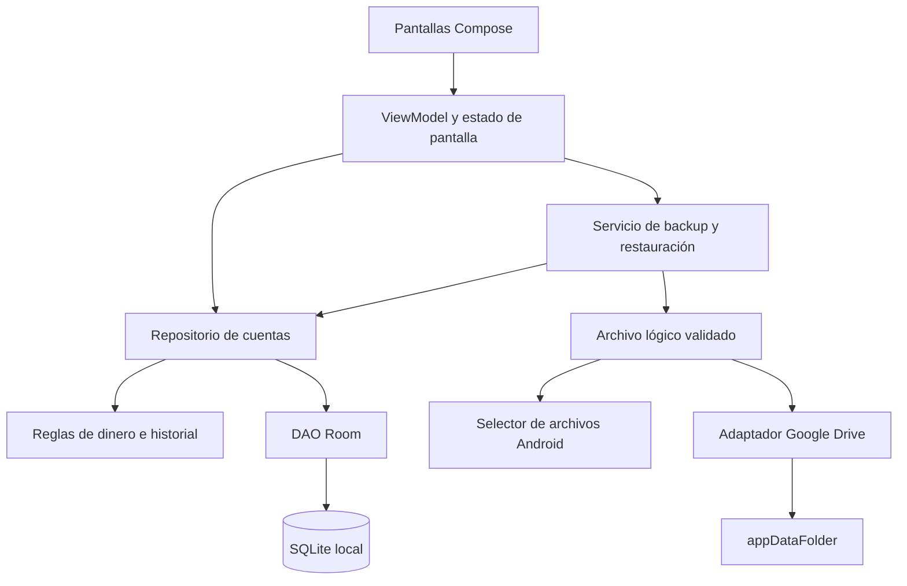

# 04 — Arquitectura y elección tecnológica

## Decisión propuesta

Aplicación Android instalada, escrita en **Kotlin**, con **Jetpack Compose**, **ViewModel/StateFlow**, **Room sobre SQLite** y corrutinas. Un único módulo `app`, construcción con Gradle Kotlin DSL y dependencias fijadas. Exportación con el selector de documentos de Android; Drive mediante autorización de Google y API v3. No hay backend propio.

La elección asume un teléfono Android y un mantenedor sin un stack previo indicado. El factor decisivo es reducir las adaptaciones entre persistencia, ciclo de vida, archivos y autorización en el único sistema operativo requerido. No se afirma que Kotlin sea siempre más fácil que Flutter ni que Compose sea más rápido sin medirlo.

## Comparación de alternativas

Las valoraciones de mantenimiento son juicios para este proyecto, no benchmarks universales. Todas requieren pruebas en el dispositivo real.

| Alternativa | Offline y SQLite | Archivos, Drive e instalación | Costo y mantenimiento para esta V1 | Decisión |
| --- | --- | --- | --- | --- |
| PWA | Offline viable con service worker e IndexedDB; SQLite requiere otra integración, por ejemplo WASM/OPFS | Instalación desde navegador; OAuth web y políticas de almacenamiento/ejecución del navegador | Aprovecha experiencia web, pero añade gestión de origen, persistencia y hosting HTTPS | No elegida para la única copia operativa de una libreta financiera |
| Android nativo | Room integra SQLite y transacciones; almacenamiento privado del sistema | Acceso directo a APIs Android, autorización Google y APK firmado | Un lenguaje de aplicación y una plataforma; SDK/Gradle requieren mantenimiento | **Elegida** |
| Web + Capacitor | App instalada; SQLite mediante plugin, con comportamiento web distinto | APK Android; archivos y autorización mediante plugins/código nativo | Conveniente si ya existe una app web; aquí agrega WebView, herramientas web y compatibilidad de plugins | Alternativa si domina ampliamente el stack web |
| React Native | Offline viable y SQLite mediante módulo nativo o paquete del ecosistema | APK y APIs nativas mediante integración; Expo SQLite es una opción si se adopta Expo | Ventaja para desarrollador React; mantener JS/TS, dependencias nativas y herramientas Android | No compensa sin requisito multiplataforma o experiencia previa |
| Flutter | SQLite mediante paquete como sqflite; offline viable | APK; Drive/autorización requieren paquete o integración de plataforma | UI consistente y una base para varios sistemas; agrega Dart y plugins al alcance Android | Segunda opción si el mantenedor ya conoce Dart/Flutter |

Fundamento técnico: la [documentación PWA](https://web.dev/learn/pwa/offline-data) describe persistencia por origen y almacenamiento que el usuario puede borrar; [Room](https://developer.android.com/training/data-storage/room) ofrece una capa sobre SQLite y verificación de consultas; [Capacitor](https://capacitorjs.com/docs/plugins) y [React Native](https://reactnative.dev/docs/native-platform) integran capacidades de plataforma mediante plugins/módulos; la [receta oficial de Flutter](https://docs.flutter.dev/cookbook/persistence/sqlite) utiliza sqflite. SQLite web sí es posible; se descarta aquí por complejidad relativa, no por imposibilidad.

Una app instalada tampoco protege frente a desinstalar, borrar datos o perder el equipo. La elección de Android no sustituye los respaldos. El costo de SDKs abiertos no elimina cuotas de servicios ni posibles costos de distribución.

Reabrir esta decisión si se confirma iPhone/web como requisito, código existente aprovechable, teléfono incompatible o una diferencia importante de experiencia del único desarrollador. Documentar el cambio antes de generar código.

## Componentes y flujo



SQLite es la autoridad de negocio. La UI observa sus resultados; Drive solo transporta instantáneas y no participa al guardar un abono.

## Patrón de arquitectura

Arquitectura por capas pequeña, con presentación MVVM y flujo unidireccional: acción → ViewModel → repositorio → transacción → estado observado → UI. Los límites permiten probar reglas y cambiar transporte de backups; no se introducen microservicios, bus de eventos, CQRS ni módulos por pantalla.

- **UI:** presentación y entradas; no calcula saldos por su cuenta ni escribe SQL.
- **ViewModel:** estado, carga, validación de formulario para feedback y coordinación. El repositorio vuelve a validar las reglas importantes.
- **Dominio:** modelos simples y funciones puras de dinero, orden e integridad. Sin Android ni una clase de caso de uso para cada botón.
- **Repositorio:** único punto de escritura de cuentas, transacciones, validación final, control de versión e idempotencia.
- **Room/DAO:** persistencia y consultas parametrizadas; saldos agregados, no sincronización.
- **BackupService / RestoreService:** captura/exportación y restauración con un único formato/validador; staging Room y reemplazo transaccional. Reutilizan las mismas reglas de negocio.
- **DriveGateway:** autorización/transporte/retención, sin decisiones financieras.

Inyección por constructores y un contenedor pequeño de aplicación. No Hilt/Koin inicialmente. Interfaces donde exista un límite que se pruebe o sustituya, como repositorio o Drive; evitar duplicar cada entidad en tres modelos idénticos. Estas decisiones adaptan las [recomendaciones de arquitectura Android](https://developer.android.com/topic/architecture/recommendations) al tamaño del proyecto.

## Stack y límites de dependencias

| Pieza | Propuesta | Justificación |
| --- | --- | --- |
| Lenguaje | Kotlin | Integración directa con Android y tipos para dinero/fechas |
| UI | Compose + componentes Material | Formularios, listas y accesibilidad sin diseñar un kit propio |
| Navegación | Navigation Compose estable | Rutas por ID; no transportar entidades completas |
| Estado | ViewModel, StateFlow y corrutinas | Observación local y operaciones fuera del hilo UI |
| Persistencia | Room + SQLite del dispositivo inicialmente | SQL controlado y migraciones probables con herramientas oficiales |
| JSON | `StrictJsonReader` y escritor mínimo propios para respaldo; `SnapshotJson` para revisiones | UTF-8 estricto, límites por campo, rechazo de claves duplicadas y profundidad limitada; sin dependencia ni plugin nuevos |
| Integridad/archivo | SHA-256 y ZIP del runtime Java/Android | Sin librería criptográfica o compresor adicionales |
| Drive | Google Identity Services AuthorizationClient + API REST v3 | Acceso limitado solo al respaldo, sin servidor |
| HTTP | Un único cliente mantenido, preferentemente OkHttp | Cancelación, timeouts y subida; justificar/fijar versión en fase 0 |
| Pruebas | JUnit, pruebas Room y Compose instrumentadas | Cubrir reglas, transacciones y recorridos críticos |

No se fijan versiones numéricas basadas en memoria. En fase 0 seleccionar versiones estables compatibles de Android Studio/JDK/AGP/Gradle/Kotlin/Compose/Room/KSP, registrar catálogo y wrapper, y construir una prueba mínima. Propuesta de compatibilidad: Android 8/API 26 en adelante, sujeta al teléfono y a los mínimos de esas versiones; no elevar el mínimo silenciosamente. `compileSdk` y `targetSdk` se fijan según soporte y requisitos vigentes de distribución.

SQLite del sistema puede variar entre versiones Android: evitar SQL reciente sin comprobar compatibilidad. El acumulado cronológico puede calcularse con Kotlin sobre la consulta ordenada, sin exigir funciones de ventana. Room y todas las migraciones se prueban en la API mínima y en una reciente. Si una versión elegida exige otro driver, evaluar el costo y documentarlo, no añadirlo automáticamente.

### JSON del respaldo: decisión implementada en la iteración 08

Se sustituye la propuesta de `kotlinx.serialization` para este contrato cerrado. `StrictJsonReader` permite rechazar una cadena durante su lectura, contar puntos de código Unicode, limitar profundidad y detectar claves duplicadas antes de construir una fila. `BackupValidator` comprueba después tipos, claves exactas, relaciones e historial. `JsonOut` escribe el contrato compacto; `SnapshotJson` conserva el formato canónico anterior de las revisiones. No se generalizan estos lectores para otros usos.

El costo es mantener un analizador propio: gramática, escapes ASCII, UTF-8 inválido, pares sustitutos, límites, lectura anticipada de los búferes y compatibilidad entre JVM y Android requieren regresiones. También hay dos lectores que revisar si cambia el contrato de snapshots. Las pruebas incluyen cadenas virtuales enormes sin materializarlas, Unicode en los límites, ZIP manipulado y archivos históricos sintéticos. Cualquier extensión debe actualizar contrato y pruebas; reconsiderar una biblioteca si reduce este costo conservando las mismas comprobaciones. Esta decisión no supone que una biblioteca general sea incapaz de implementarlas.

La lectura y escritura son por streaming de bytes/caracteres, pero la captura Room y la validación **conservan listas de filas en memoria** para comprobar relaciones e historial. No se promete memoria constante. Las listas de captura dejan de estar referenciadas antes de validar; el GC decide cuándo libera su memoria. Las mediciones y su alcance están en [19 — Respaldo en archivo](19_Respaldo_Archivo.md).

En la iteración 09 el mismo validador entrega las filas ya comprobadas al importador Room, sin un segundo parser. Después de importar se dejan de referenciar las listas globales; el staging se comprueba por cuenta con las mismas reglas y se copia por cursores a la transacción operativa. La cuenta mayor todavía puede requerir memoria proporcional. No se intercambian bases abiertas. Exclusión, épocas, protección previa y marcador de commit en [20 — Restauración](20_Restauracion_Archivo.md).

## Estructura del repositorio

Estructura presente (2026-10-06): proyecto Gradle con wrapper y catálogo, módulo `app` con `MainActivity` y tema; detalle en [12 — Arranque técnico](12_Arranque_Tecnico.md). No se crean carpetas vacías ni archivos Kotlin que sugieran funciones inexistentes.

Estructura objetivo de fase 1, que se completará por incrementos:

```text
Paga_ya/
├── README.md
├── docs/                         # Requisitos y decisiones
├── gradle/libs.versions.toml      # Versiones fijadas
├── gradle/wrapper/               # Wrapper versionado
├── gradlew / gradlew.bat
├── settings.gradle.kts
├── build.gradle.kts
└── app/
    ├── build.gradle.kts
    ├── schemas/                  # Esquemas Room versionados
    └── src/
        ├── main/
        │   ├── AndroidManifest.xml
        │   ├── java/<paquete>/
        │   │   ├── PagaYaApplication.kt
        │   │   ├── MainActivity.kt
        │   │   ├── ui/           # clientes, cuenta, movimiento, respaldo, tema
        │   │   ├── domain/       # modelos y validadores pequeños
        │   │   ├── data/
        │   │   │   ├── local/    # Room, DAO, entidades, migraciones
        │   │   │   ├── repository/
        │   │   │   └── backup/   # formato, exportación, importación, Drive
        │   │   └── platform/     # reloj, documentos, autorización, contenedor
        │   └── res/              # strings y reglas de respaldo del sistema
        ├── test/                 # reglas y fixtures sintéticos
        └── androidTest/          # Room, migraciones, UI y recuperación
```

El identificador de paquete se elegirá con el propietario antes de registrar OAuth y firmar una release; no usar un dominio ajeno. Cambiarlo después puede afectar instalación y acceso a copias. Separar credenciales y datos de prueba de producción.

## Convenciones técnicas

- Documentación y mensajes de UI en español; clases/campos Kotlin en inglés coherente, con mapeo explícito a los nombres lógicos de estos documentos. Las claves exportadas del backup se mantienen estables en español.
- Strings de UI en recursos; `es-CO`, `COP`, sin decimales. Entrada numérica estricta y formato de presentación independiente.
- Acceso a disco/red fuera del hilo principal. Una sola instancia Room; transacciones serializan las escrituras.
- Captura de backup y restauración coordinadas con el repositorio; ningún DAO público de escritura usado directamente desde pantallas.
- IDs estables, reloj inyectable para pruebas y errores de dominio traducidos a mensajes cotidianos.
- Commits pequeños; cambios de esquema incluyen migración y prueba. Sin datos reales en fixtures o reportes.
- No telemetría remota, anuncios, servicio propio ni tareas permanentes en segundo plano en V1.

## Seguridad de la plataforma

Guardar SQLite en el directorio privado; nunca en caché o Descargas. No pedir acceso general a archivos o contactos. El selector Android concede acceso al documento escogido, según el [Storage Access Framework](https://developer.android.com/training/data-storage/shared/documents-files).

Configurar explícitamente el respaldo automático del sistema: excluir BD, credenciales, archivos temporales y preferencias sensibles de Auto Backup y transferencias no previstas. Usar `allowBackup` y reglas de extracción según API, y verificarlo en el equipo real: Android documenta diferencias de transferencias entre fabricantes, por lo que un atributo aislado no basta. [Respaldo Android](https://developer.android.com/identity/data/autobackup).

El respaldo autorizado de Paga Ya! debe ser comprensible y comprobable. No depender de un segundo mecanismo opaco de restauración automática para dar por cumplida HU-09.
