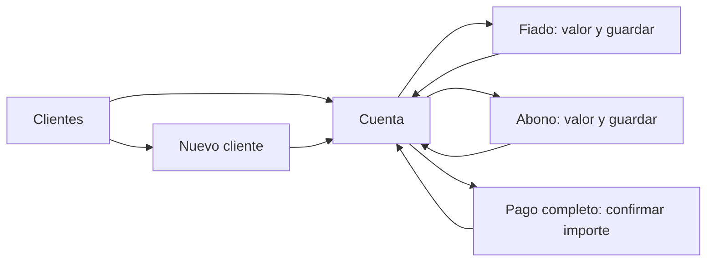

# 06 — UX y flujos principales

## Intención de uso

Modo de uso: operar una libreta mientras se atiende a un cliente. El éxito es guardar el importe correcto en la cuenta correcta y reconocer de inmediato cuánto falta por pagar. La marca familiar que se conserva del cuaderno es el abono claramente señalado.

Esta es una propuesta de interacción de baja fidelidad basada en el encargo; no es un diseño visual aprobado ni una interfaz implementada. La fase 0 valida los recorridos con la vendedora. No se define todavía un logotipo, ilustraciones ni una identidad gráfica extensa.

Tres pantallas concentran el uso diario. Crear/editar cliente usa un formulario secundario. Respaldo, revisión de cambios y confirmaciones son destinos auxiliares; no compiten con las acciones Fiado y Abono.

## Pantalla 1 — Clientes

Datos ficticios; ejemplos monetarios en COP.

```text
Paga Ya!                           ⋮

[ Buscar cliente…                  ]

María Pérez
Debe: $45.000                  >

Claudia Rojas
Pagado ✓                       >

Ana Torres
Debe: $83.000                  >

          [ + Nuevo cliente ]
```

La fila completa abre la cuenta. Orden alfabético estable; conservar búsqueda y posición al regresar. El teléfono aparece como segunda referencia cuando ayuda a distinguir homónimos, sin llenar todas las filas de texto accesorio. «Respaldo» y «Archivados» están en el menú; no se agrega dashboard, gráfico ni resumen contable al inicio.

Sin clientes: «Aquí verás las cuentas de tus clientes» y «Crear primer cliente». Si la búsqueda no coincide: «No encontramos ese nombre», con acción para limpiar o crear. Un nombre repetido muestra una advertencia breve al crear, sin impedir continuar.

Sin movimientos vigentes: «Sin movimientos», no «Pagado ✓». Una cuenta que vuelve a tener deuda después de pagarse muestra «Debe». Si solo hay movimientos anulados, mostrar «Sin movimientos vigentes» y mantener acceso al historial.

## Pantalla 2 — Cuenta del cliente

```text
< Clientes        María Pérez      ⋮

Saldo pendiente
$45.000

[ Pagar saldo completo ]

3 oct 2026
✓ Abono                    −$15.000
Transferencia
Saldo después: $45.000
─────────────────────────────────
1 oct 2026
Fiado                      +$60.000
Pedido de revista
Saldo después: $60.000

[ + FIADO ]         [ + ABONO ]
```

Saldo en la primera región visible. Historia del más reciente al más antiguo con fecha completa accesible. Cada abono/pago combina ✓, texto, signo menos y realce suave de fondo o subrayado del importe. El fiado usa signo más y texto. No tachar abonos: el tachado queda asociado a anulaciones, no a dinero recibido.

Los botones inferiores permanecen accesibles, con tamaño suficiente y margen respecto a navegación del sistema. «Pagar saldo completo» es secundario. Con saldo cero se desactiva Abono con explicación contextual «No hay saldo pendiente» y se oculta el atajo de pago.

Tocar un movimiento abre su detalle: información completa, marca «Editado» cuando corresponde, «Ver cambios», «Corregir» y «Anular». No usar pulsación prolongada o gestos ocultos como único acceso.

Una fila anulada dice «Anulado · no afecta el saldo», conserva el valor como referencia y es visualmente secundaria. El importe puede estar tachado, pero sigue siendo legible. Un pago parcial no marca productos específicos como pagados; la deuda pertenece a la cuenta global.

## Pantalla 3 — Registrar movimiento

```text
< Volver             Registrar abono

María Pérez
Debe: $45.000

Valor
$ [ 20.000                        ]

Fecha                   05/10/2026
Nota opcional
[                                 ]

            [ Guardar abono ]
```

Cliente fijado por el contexto. Teclado numérico abierto y foco en valor; fecha de hoy preseleccionada. No elegir tipo nuevamente si se llegó desde «+ Abono» o «+ Fiado». La nota no es obligatoria ni recibe foco antes del valor. El nombre de la acción cambia según el movimiento.

El usuario digita pesos completos, por ejemplo `20000`; el formato visual puede agrupar como `20.000`. Al pegar, aceptar solo dígitos o agrupación colombiana inequívoca (`20.000`, `$20.000`); rechazar `20,5`, `20.000,50`, notación científica, signos negativos y agrupaciones incorrectas. Nunca eliminar separadores de manera que transforme fracciones en miles. Mostrar el importe formateado antes del botón Guardar.

Al confirmar: desactivar temporalmente Guardar, persistir, volver a la cuenta y mostrar «Abono guardado». No agregar un diálogo para cada movimiento normal. Si falla: conservar valores, explicar y permitir reintento. Si se abandona un formulario con cambios sin guardar, confirmar descarte; no crear movimientos incompletos automáticamente.

## Recorridos



Desde una cuenta abierta, el camino habitual es tocar Fiado/Abono, escribir valor y guardar. La meta de diez segundos se mide sobre este recorrido. Buscar al cliente es un costo separado que también debe mantenerse bajo.

### Corrección y anulación

1. Abrir movimiento y elegir Corregir.
2. Cambiar importe, fecha o nota y escribir motivo breve; pueden ofrecerse motivos cotidianos predefinidos, siempre conservando texto.
3. Mostrar comparación compacta: «Valor anterior: $20.000 · Nuevo: $25.000 · Nuevo saldo: $40.000».
4. Confirmar «Guardar corrección»; ante conflicto o saldo inválido, mantener el formulario y explicar qué se debe revisar.

Anular se ubica en el detalle, fuera de acciones principales. Confirmación: «Anular el abono de $20.000 de María del 5 oct. Su saldo quedará en $65.000». Se exige motivo. No usar solo «¿Estás seguro?» ni deslizar para borrar. No ofrecer un botón Deshacer que borre la trazabilidad.

### Pago completo

«Registrar pago de $45.000 de María» → «Confirmar pago». La app no cobra dinero ni abre una pasarela: registra un pago ya recibido. Si cambia el saldo, actualizar la confirmación antes de guardar. La fecha inicial es hoy; una corrección posterior sigue HU-08.

### Respaldo

```text
< Clientes                    Respaldo

Última copia en Drive
5 oct, 9:30 p. m.
Cuenta: correo de la usuaria
Hay cambios sin respaldar

[ Guardar copia en Google Drive ]
[ Guardar copia en archivo      ]
[ Recuperar cuentas             ]
```

Sin Drive conectado, mostrar «Conectar Google Drive». Explicar una vez que allí se guardarán copias autorizadas y que la app funciona sin conexión. En exportación: «Esta copia contiene las cuentas de tus clientes. Guárdala en un lugar privado». No prometer protección ante pérdida del teléfono por una copia que solo quedó en su almacenamiento interno.

Recuperar cuentas: elegir origen → elegir copia → validar → vista previa → confirmar reemplazo → progreso → resultado. La primera apertura vacía también ofrece «Recuperar cuentas». Nunca pedir crear clientes primero para acceder a restauración.

## Estados y mensajes

| Situación | Mensaje/acción esperada |
| --- | --- |
| Valor vacío o cero | «Escribe un valor mayor que cero» |
| Fracciones | «Escribe el valor en pesos completos» |
| Abono excesivo | «El abono supera lo que debe: $45.000» |
| Fecha incompatible con deuda | «En esa fecha aún no había deuda suficiente. Revisa la fecha o los movimientos anteriores» |
| Corrección inválida | «Este cambio dejaría un abono sin deuda que cubrir. Revisa el abono del…» |
| Guardado sin espacio | «No se pudo guardar. Libera espacio e inténtalo de nuevo»; conservar formulario |
| Carga del saldo | Indicador de carga breve; nunca un $0 provisional |
| Error al leer BD | «No pudimos abrir las cuentas» con reintento y recuperación; no crear BD vacía silenciosamente |
| Sin red al respaldar | «No hay conexión. Tus cuentas siguen guardadas en este teléfono» |
| Backup dañado | «Esta copia está incompleta o dañada. Tus cuentas actuales no cambiaron» |
| Backup futuro | «Esta copia necesita una versión más reciente de Paga Ya!» |
| Restaurar libreta vacía | Advertir explícitamente que reemplazará las cuentas por una libreta sin clientes |
| App cerrada durante restauración | Al volver, informar el resultado según el marcador transaccional |

La UI muestra acciones posibles sin códigos HTTP, SQL, tokens, checksums ni nombres de tablas. Esos detalles pertenecen a diagnóstico privado y documentación del desarrollador.

## Accesibilidad y comprobación

- Áreas táctiles de al menos 48 dp; acciones principales preferiblemente 56 dp de alto.
- Texto legible, contraste objetivo de 4,5:1 para texto normal y 3:1 para texto grande/elementos relevantes. Confirmar con herramientas durante implementación.
- ✓ acompañado de «Abono» o «Pago» y texto accesible, por ejemplo «Abono de veinte mil pesos, cinco de octubre».
- Soportar TalkBack, foco lógico y aumento de fuente al 200 % sin ocultar importe, saldo o acción Guardar.
- Pantallas pequeñas: diseño vertical, desplazamiento con teclado y barras del sistema; botones no superpuestos al formulario.
- Notas largas se resumen en lista y se leen completas al abrir. Importes máximos no se cortan ni reducen a abreviaturas ambiguas.
- Sin animaciones que retrasen el registro, fuentes remotas, iconos descargados o dependencia de Internet.

En fase 0 realizar un recorrido con datos ficticios: fiado $60.000, abono $15.000 y pago $45.000. Pedir a la usuaria que encuentre la cuenta, explique los signos y distinga pago de anulación. Corregir el flujo antes de programar estética adicional.
